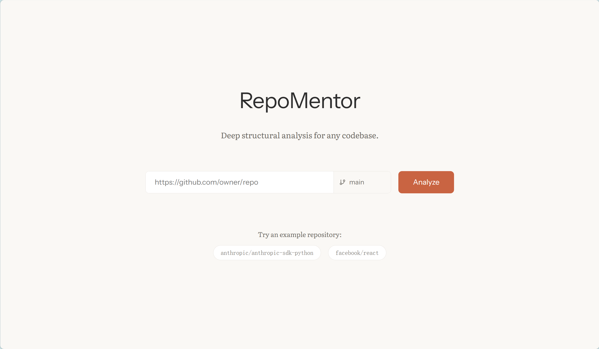
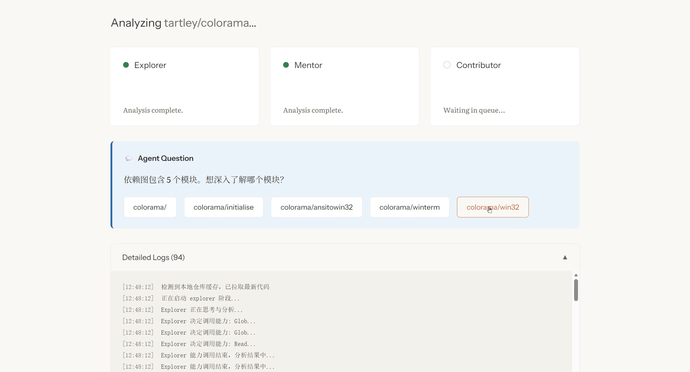
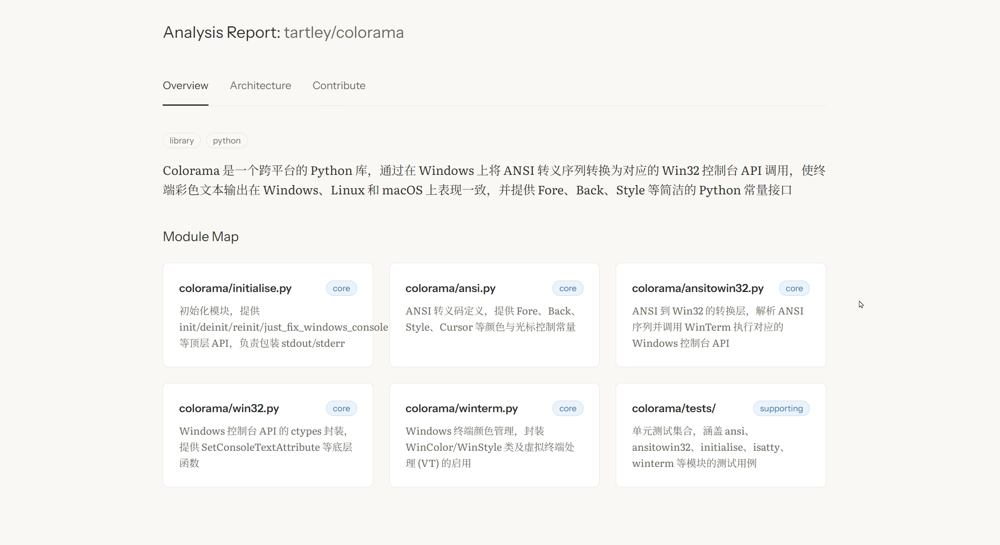
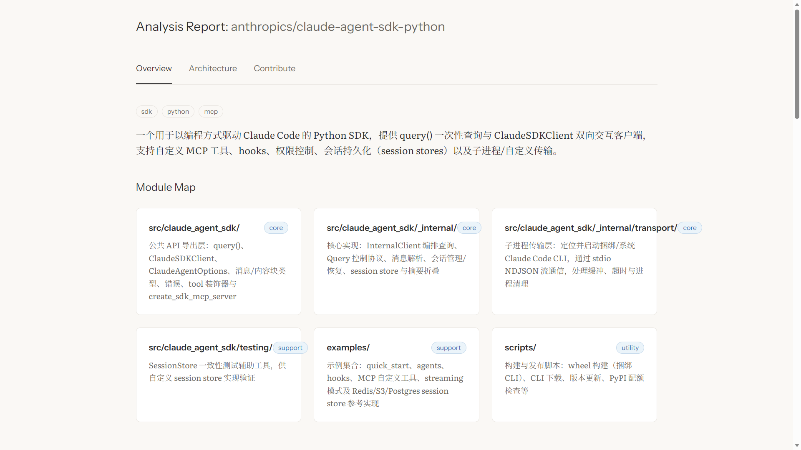
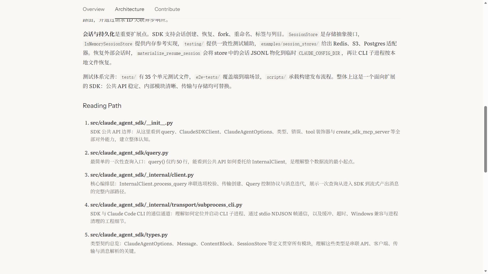
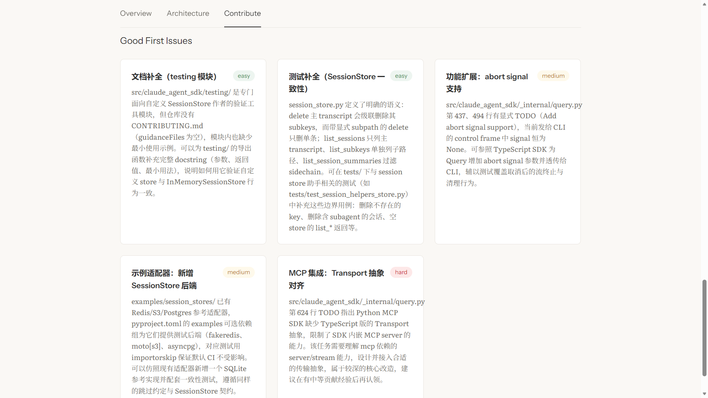

# RepoMentor

[](https://github.com/Freesia2077/RepoMentor/actions/workflows/python.yml)

面向开发者学习和接手开源仓库，围绕架构理解、源码阅读、跨文件调用与实现逻辑问答，探索两条互补路线：**用 Agentic RAG 改善取证，用小模型后训练学习工具使用与基于证据作答。**

## 项目概览

| 项目 | 解决的问题 | 技术主线 | 代码与文档 |
| --- | --- | --- | --- |
| **Agentic RAG 仓库学习助手** | 从仓库中定位相关源码，按问题补查，并给出带来源的解释 | Qwen3.5-9B · Tree-sitter · BM25 / FAISS · RRF · Qwen3 重排 · OpenAI Agents SDK · Harness | [源码](python/src/repomentor/) · [使用说明](python/README.md) · [50题评测](python/experiments/sweqa-50-2026-11-03/README.md) |
| **Qwen3.5-2B 工具后训练** | 让小模型学习多轮搜索、读源码和组织回答的行为 | PyTorch · Transformers · TRL · PEFT / LoRA · SFT · GRPO · Datasets · Accelerate | [独立源码](python/src/sftgrpo/) · [训练说明](python/SFTGRPO/README.md) |

两个项目以 Python 为当前开发主线，源码分别位于 `python/src/repomentor/` 和 `python/src/sftgrpo/`。早期 TypeScript 全栈应用保留在仓库根目录，页面演示见文末。

## 项目一：Agentic RAG 仓库学习助手

输入仓库与具体问题，输出源码解释、引用及后续阅读线索。`ask` / `chat` 支持单轮与连续问答；`report` 按 Explorer → Mentor → Contributor 阶段生成模块概览、架构说明、源码阅读路线与贡献准备建议。

### 核心实现

- **代码检索：** 固定 Git 快照，使用 Tree-sitter 按声明结构切分，保留路径与原始行号；支持 BM25、归一化向量与 FAISS 检索，通过 RRF 融合和 Qwen3-Embedding / Reranker-0.6B 完成混合召回与重排。符号、路径及有限静态依赖辅助定位源码。
- **按需取证：** 先提供初始检索结果，再由 OpenAI Agents SDK Runner 围绕证据缺口调用六类只读工具，搜索代码/文档、读取原文、查找测试、定位符号和浏览依赖。单次 RAG 与 Agent 共用检索和选源组件。
- **Agent Harness：** 管理上下文裁剪、工具去重、调用预算、超时和检查点恢复；区分已读取源码与当前模型可见源码，按实际输入核验引用的文件和行号范围。
- **运行留痕：** 保存问题、源码快照、检索结果、模型实际输入、工具轨迹与原始回答，支持恢复会话和离线查看具体案例。

目标仓库采用只读固定快照。当前默认入口为 CPU 代码增强 BM25 + SDK Agent；混合重排通过 `--retriever hybrid-rerank` 显式启用。检索器、Agent 循环和运行约束各自独立，便于对照与失败归因。

### SWE-QA 评测

固定 **Qwen3.5-9B Q4_K_M、16K 上下文**，在 SWE-QA 的 Flask、Requests、Pytest、Streamlink 四个仓库共 **50题**上完成五组对照，保留 **250份答案与评分**。闭卷组只接收问题和仓库信息；各 RAG 组读取对应固定版本的真实源码。

| 条件 | 五维评分均值 / 100 | 平均生成请求 / 题 |
| --- | ---: | ---: |
| 闭卷，无 RAG | 47.64 | 1.0 |
| 普通 BM25 RAG | 64.46 | 1.0 |
| 代码增强 BM25 RAG | 63.36 | 1.0 |
| 混合检索重排 RAG | 70.52 | 1.0 |
| Agentic RAG | **77.96** | **4.5** |

在该固定子集上，Agentic RAG 相对普通 BM25 提高 **13.50分**，同时增加生成请求；代码增强组低于普通 BM25。评分采用正确性、完整性、相关性、清晰度和推理质量五维模型辅助量表，结论按本样本解释。

[完整报告](python/experiments/sweqa-50-2026-11-03/README.md)包含选题与仓库版本、逐题差值、成本、原始输出和失败分析。重点复查目标声明漏召回、已见源码理解错误、重复取证及参考答案冲突，依据实际输入区分检索问题和回答问题。

## 项目二：Qwen3.5-2B 多轮工具后训练

面向跨文件调用、配置处理和实现逻辑问答，将学习目标从“生成最终答案”扩展到“搜索—读源码—推理—调用工具—回答”的完整助手行为。使用 SWE-QA-Pro 公开教师轨迹，沿用其三类工具协议：`semantic_search`、`view_codebase`、`execute_readonly_command`；在线采样使用 TRL 的多轮工具循环。

### 数据、监督与训练

- **数据处理：** 归一化角色，配对工具调用与已有观察，恢复公开轨迹中嵌入的工具返回；按仓库名隔离来源，排除评测库和 RAG 保留库，保留 32K 内调用闭合、包含最终回答的轨迹。输出重复调用、错误观察、外部催停等行为标记，供数据审核。
- **监督对照：** 在相同完整输入、样本顺序和更新预算下，比较末条助手消息监督与全助手轨迹监督。全轨迹模式覆盖规划、工具调用与回答；系统、用户、工具观察和 padding 的标签设为 `-100`。
- **在线 GRPO：** 从全轨迹 SFT 出发，对同一问题采样多条工具轨迹，以终点奖励计算组内相对优势，结合冻结 SFT 参考策略的 KL 项更新。支持原五维质量奖励与证据约束奖励的对照，使用 TRL 的 token 级目标和 DAPO 式词元聚合。

以下为仓库的**默认训练与评测配置**，参数集中在 [run-config.json](python/SFTGRPO/run-config.json) 和 [data-policy.json](python/SFTGRPO/data-policy.json)。

| 配置项 | 设置 |
| --- | --- |
| 基座与适配 | Qwen3.5-2B；BF16；LoRA r=16、alpha=32、all-linear |
| SFT 数据与预算 | 963条训练 / 32条开发轨迹；32K；两种监督条件各 2 epochs；学习率 1e-4 |
| GRPO 采样与更新 | 128题 × 4候选；1 epoch；学习率 1e-6；KL 系数 0.02 |
| 工具与生成预算 | 最多 32轮工具交互；后续总预算 30,720 tokens，包含观察与控制；预留回答空间 |
| 四组评测配置 | 六库30题；原模型、末条消息 SFT、全轨迹 SFT、全轨迹 SFT + GRPO；统一工具、提示与预算 |

### 奖励设计与稳定性

- **约束 Reward Hacking：** 五维终点奖励结合模型实际可见源码与引用核验，检查关键事实是否被证据支持；事实错误或证据不足时限制奖励。质量达标后才对精确重复调用施加有上限的惩罚，保留必要搜索与错误恢复的空间。
- **处理评分故障：** 默认 grounded 模式下，候选评分或证据审核失败会保存原文并阻止该组更新；分别记录基础质量分、奖励门控原因和重复扣分。
- **控制训练资源：** 训练使用梯度检查点与 FlashAttention / 高效 SDPA，采样启用原生缓存；检查点保存 adapter、优化器、调度器、RNG 和数据/源码身份，支持在完整更新后停止及恢复。只读工具隔离、超时与费用账本限制在线运行成本。

[训练说明](python/SFTGRPO/README.md)提供数据准备、预检、两种 SFT、GRPO、断点恢复与四组答案采集命令；[奖励实现](python/src/sftgrpo/rewards.py)和[工具环境](python/src/sftgrpo/runtime.py)给出具体规则。模型权重、凭据、展开后的仓库缓存和训练输出保留在本地忽略路径中。

## 使用入口

### RAG

需要 Python 3.12 / 3.13 与 Git。从源码安装并检查环境：

```bash
git clone https://github.com/Freesia2077/RepoMentor.git
cd RepoMentor/python
python -s -m pip install -e ".[dev]"
python -s -m repomentor.cli doctor
```

按[配置示例](python/config/model-settings.example.json)设置 Python 独立的模型接口；本地模型服务与检索权重准备见[辅助脚本说明](python/scripts/README.md)。神经检索依赖通过 `.[rag]` 安装。配置完成后固定仓库版本，使用输出的 `snapshot_id` 启动对话：

```bash
python -s -m repomentor.cli snapshot https://github.com/jd/tenacity.git --revision 32ac68f0941319c0d2f4fb927f96e4ee29bb46c6
python -s -m repomentor.cli chat --snapshot-id SNAPSHOT_ID
```

也可直接查看保存的评测答案与源码，整个过程离线运行：

```bash
python -s -m repomentor.cli inspect-run experiments/sweqa-50-2026-11-03/combined/results.jsonl --case-id sweqa-flask-042--hybrid_rerank
python -s scripts/verify_archives.py
python -s -m repomentor.cli questions verify
```

Windows 本机可使用 `python/run.ps1` 调用指定环境。更多问答、报告与会话命令见[Python 使用说明](python/README.md)。

### 后训练

后训练依赖与 CUDA 内核单独列在 [requirements.txt](python/SFTGRPO/requirements.txt) 和 [requirements-cuda.txt](python/SFTGRPO/requirements-cuda.txt)。按[训练说明](python/SFTGRPO/README.md)安装后，从 `python/` 目录准备数据并执行 CPU 预检：

```bash
python -s -m sftgrpo.prepare fetch
python -s -m sftgrpo.prepare data
python -s -m sftgrpo.train preflight
```

在线工具隔离与 GPU 训练使用 Linux 环境。正式训练、资源预检、检查点及评测复核流程统一在后训练 README 维护。

## 仓库结构与文档

```text
RepoMentor/
├── python/
│   ├── src/repomentor/   # RAG、SDK Agent、Harness、CLI 与评测
│   ├── src/sftgrpo/     # 轨迹处理、SFT、GRPO、奖励与工具环境
│   ├── SFTGRPO/         # 后训练配置、依赖和测试
│   ├── experiments/     # 评测结果、原始答案与来源链
│   └── tests/           # Python 核心离线回归
├── src/                 # 原 TypeScript 后端
├── web/                 # 原 React 前端
└── demo/                # 原 Web 版截图
```

- [Python 当前实现与模块职责](python/项目文档.md)
- [RAG 50题评测与失败分析](python/experiments/sweqa-50-2026-11-03/README.md)
- [保留实验与数据来源](python/experiments/README.md)
- [后训练配置与运行说明](python/SFTGRPO/README.md)

## 原 TypeScript 全栈版本

[](https://nodejs.org/)
[](https://www.typescriptlang.org/)

早期版本以 **React + Vite / Fastify + TypeScript / SQLite** 提供仓库报告页面，通过 SSE 展示任务进度，交付项目概览、模块图、架构、阅读路线与贡献建议。当前 Python 两项目独立运行；以下截图展示原 Web 应用。

在仓库根目录使用 Node.js 20.19+ 启动：

```bash
npm install
npm start
```

启动后在页面的 **Model Settings** 中配置模型，默认服务地址为 `http://localhost:3000`。源码与前后端脚本保留原位。

<details>
<summary>查看原 Web 版的六张截图</summary>

**输入开源仓库**

<p align="center">
  
</p>

**查看实时分析进度**

<p align="center">
  
</p>

**浏览结构化报告**

<p align="center">
  
</p>

**项目概览与模块图**

<p align="center">
  
</p>

**架构与源码阅读路线**

<p align="center">
  
</p>

**贡献建议**

<p align="center">
  
</p>

</details>
