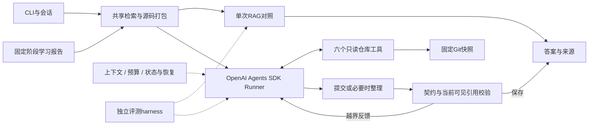

# 当前架构

本页维护实现职责；功能与效果见[项目文档](../项目文档.md)，参数见[配置](configuration.md)，原件见[实验索引](experiment-index.md)。

## 主路径

检索器决定初始原文，engine决定是否继续补查。默认问答为代码增强BM25与单Agent；报告的explorer、mentor、contributor按固定顺序执行。可选专家默认关闭，不据此主张多Agent收益。

## 模块职责

| 模块 | 职责 |
| --- | --- |
| `contracts.py`、`execution.py`、`records.py` | 契约、取消/异常、原子保存 |
| `repository.py`、`paths.py`、`config.py` | 固定快照、范围和Python独立配置 |
| `chunking.py`、`retrieval_policy.py`、`retrieval_factory.py` | 切分、候选与预算、检索装配 |
| `retrieval.py`、`neural_retrieval.py`、`hybrid_retrieval.py` | BM25、归一化向量、FAISS、RRF和重排 |
| `code_retrieval.py`、`code_navigation.py`、`entry_scope.py` | 符号、有限静态关系及入口约束 |
| `agent_tools.py`、`source_windows.py` | 工具契约、原文范围/哈希、去重和未读区间续读 |
| `rag.py`、`source_context.py`、`shared_sources.py` | 共用取证、原文打包和完整输入预算 |
| `sdk_agent.py`、`sdk_context.py` | SDK接入、上下文取舍、提交边界和运行检查点 |
| `runtimes/chat.py`、`runtimes/openai_sdk.py` | 模型协议、配置身份和真实请求记录 |
| `conversation.py`、`context_memory.py` | 会话身份、当前目标、缺口及恢复 |
| `benchmark.py`、`semantic_review.py`、`experiment_ledger.py` | 冻结评测、来源绑定的评审与请求记账 |
| `cli.py`、`presentation.py` | 用户入口和离线展示 |

## Agent harness的关键约束

1. **原文交付：** 普通RAG与Agent复用选择器、窗口、行号和哈希。明确符号、静态关系、测试及可靠导入绑定提供定位候选，不能当作已执行调用或测试覆盖。
2. **可见性：** SDK调用前整理完整消息对，分别记录已存档和当前可见源码。裁掉的原文可在预算内重新读取，旧摘要和导航元数据不能替代引用依据。
3. **提交：** `RepositoryAnswer`共用作答与提交契约。引用按该次模型调用前的可见来源检查；同批读取须进入下一次输入后才可引用。非法提交反馈给SDK继续处理，合法提交可结束；范围校验不判断语义正确。
4. **预算与恢复：** 模型请求、仓库操作、源码和墙钟分别限制。被拒重复操作也计额度；显式恢复复用已有工具结果，完成请求可回放。发送不确定不自动重发，不承诺远端恰好执行一次。
5. **记录：** 保留真实请求、原始回答、工具返回、上下文取舍与停止原因。评测harness使用正常引擎，不另写Agent循环；流程成功与答案正确分别评估。

同批读取与提交、模型边界恢复的行为见[SDK测试](../tests/test_sdk_agent.py)；原理与案例见[面试技术问答](rag-interview-assessment.md)。

## 运行资产与兼容入口

`src/repomentor/assets/`中的技能和角色说明是运行资产，测试fixture中的文档也是测试数据，不能作为冗余说明删除。Python普通运行和测试无需Node、TS或前端，也不读取其模型设置。

`harness.py`主要服务旧报告；`sdk_report.py`和`sdk_collaboration.py`保留辅助报告及默认关闭的专家能力。Claude与旧固定上下文报告为显式兼容入口，stub用于离线验证。历史批次只读核验，不为旧结果恢复自研循环或强改实现身份。
