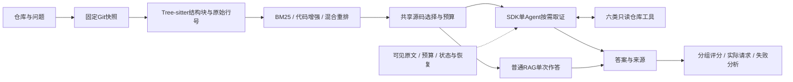

# RepoMentor：项目讲述与面试演示

2026-11-04。简历直接复制[项目段落](resume-project.md)；公式、实现与追问读[技术问答](rag-interview-assessment.md)；量化结论以[SWE-QA 50题报告](../experiments/sweqa-50-2026-11-03/README.md)为准。本页使用封版实现与保存结果，不追加模型实验。

## 1. 项目定位

**RepoMentor是面向开发者的开源仓库学习助手。** 用户可以先了解架构和入口、获得源码阅读路线，再围绕函数、模块关系与测试连续追问。面试先说明这条学习过程，再用具体函数或参数行为展开源码案例；接入查证是其中一类问题。

| 业务问题 | 当前交付 | 验证范围 |
| --- | --- | --- |
| 陌生库的入口和模块怎样组织？ | 仓库概览、阅读路线 | 功能已有，学习效率未独立测量 |
| 参数组合、控制流和测试怎样约束行为？ | 行为解释、源码位置、必要时继续补查 | 主要量化范围：公开源码问答与接入案例 |
| 接入或贡献前该检查什么？ | 实现/测试阅读建议、依据与缺口 | 不执行目标仓库，不自动修改或提交PR |

这是个人研究原型。业务价值主张是把架构导览、阅读路线和有源码依据的追问串联为连续学习过程；目前没有真实团队上线、真人省时或贡献成功率数据。

## 2. 30秒介绍

> 我做的是RepoMentor，一款开源仓库学习助手，提供架构导览、源码阅读路线和多轮问答。项目结合代码检索与Agent按需补查，并通过harness管理可见源码、引用和调用预算。在SWE-QA四库50题对照中，Agent模型辅助均分77.96，普通BM25是64.46，平均生成请求分别4.5次和1次。我重点做了检索、运行约束和失败归因。

## 3. 两分钟介绍

> 开发者学习陌生仓库时，通常先找入口和模块，再沿源码理解函数、依赖与测试。RepoMentor提供架构导览、阅读路线与连续问答，让用户从“先读哪里”逐步问到“为什么这样实现”，解释可以回到原始源码核对。
>
> 我将仓库固定到Git提交，用Tree-sitter切分并保留行号，采用BM25与向量召回、RRF融合及重排。Agent复用初始证据，通过六个只读工具查实现、测试和依赖，循环交给OpenAI Agents SDK。
>
> 我围绕SDK构建了任务harness，处理原文交付、上下文、工具预算和恢复。重点是存档有源码不代表当前模型看到了，同批刚要求读取的原文也不能倒填为已读依据，所以按模型调用前的可见来源检查引用。
>
> 评测采用SWE-QA四库50题、五组对照，共250份答案。模型辅助均分中，BM25是64.46，混合70.52，Agent77.96；Agent平均生成请求4.5次，混合为1次，且16题退步。旧20题已用于开发，新30题单列，这是完整流程比较。
>
> 我也保留了代码增强的负结果。一道Pytest题中，增强组已见完整类，却先说不存在、再正确描述它。关键是区分没找到、没交付和读错了，从真实输入解释失败，再决定是否值得改已有组件。

## 4. 白板结构



普通问答的产品默认是代码增强BM25/CPU；公开评测的Agent显式选用混合重排。学习报告中的explorer、mentor、contributor是固定串行阶段，普通问答为单Agent。介绍时只需画出当前使用的路径，再根据追问展开。

## 5. 三个可展开的故事

### A. 检索成功：没有类声明，相关方法仍不够

**问题：** Flask-042需要解释TestUrlFor及相关测试。两种BM25只交付局部方法，缺类声明和部分所问测试，评分均为35。

**核查：** 比对实际请求中的源码，混合路径交付了`tests/test_helpers.py`的102–169类段，混合与Agent评分均为98；Agent本题没有调用仓库工具。

**结论：** 本例收益来自更完整的初始证据。结构索引能定位函数，不保证最终预算打包保留了回答需要的结构关系。不能把98分记成工具补查成功，也没有单独隔离向量、RRF和重排各自贡献。

原件：[源码与分数复核](../experiments/sweqa-50-2026-11-03/failure-analysis.json)、[实际请求来源检查](../experiments/sweqa-50-2026-11-03/wire-source-audit.json)。

### B. Agent补查：找到后续覆盖赋值，纠正参数组合误判

**问题：** Requests的`prepare_body(data=None, files=..., json=...)`，初始窗口缺551–557，模型误把非流式调用解释为流式冲突。

**过程：** 工具臂先请求550–570，实际新增交付未读551–557；下一次模型输入出现554–555的multipart覆盖赋值，研究稿在最后整理前已解释正确。禁用仓库工具的对照误答，两臂首个实际请求除工具列表外一致，提交能力相同。

**结果与边界：** 工具臂5次模型请求、3次仓库操作，对照1次、0次；支持这个已知单例中“允许补查”的完整运行方式有收益，未隔离新增信息与额外推理。它是业务解释案例，不并入公共50题分母。

原件：[两臂输出](../experiments/business-steps-submission/results.jsonl)、[输入与来源复核](../experiments/business-steps-submission/summary.json)。

### C. 负结果：证据充分，增强和更多工具仍会变差

**Pytest-017：** BM25为90，代码增强59。实际输入含相同六段源码，仅顺序不同；增强组已见完整TestReadme类，却先说不存在、再准确描述。应归为证据理解与拒答校准失败，单次结果不能证明排序是唯一原因。

**Flask-048：** 混合88，Agent67。初始均有完整异常处理方法，Agent再做3次仓库操作，仍把命中即return解释为继续遍历所有MRO。源码缺口不足以解释错误，多调用没有必然收益。

**反思：** 先看该次模型真正收到什么，再区分没召回、没交付、误读和停止判断。下一步优先检验已有选源器的角色先验和回答中的条件一致性；这些是改进方向，封版结果没有据此重跑。原件：[失败分析](../experiments/sweqa-50-2026-11-03/failure-analysis.json)。

## 6. 工程深挖备用：同批读取与提交

同一次模型输出包含`read_code(L3)`与`submit_answer(引用L3)`，即使工具按顺序执行，提交参数仍在模型看到L3前生成。若只查全局已读存档，就会错误接受这种引用。

当前按该次模型输入的可见来源校验：本轮拒绝越界引用，L3进入下一次模型输入后才允许重新提交。SDK继续管理循环，应用提供工具错误与预算。这个行为由真实SDK Runner配合脚本模型离线验证；不表示本地Qwen已在线展示该恢复，也不能证明引用中的自然语言解释正确。

代码：[提交边界](../src/repomentor/sdk_agent.py)、[可见上下文](../src/repomentor/sdk_context.py)、[测试](../tests/test_sdk_agent.py)。

## 7. 五分钟离线演示

从`python/`执行，沿用`run.ps1`指定的项目环境，不启动模型服务、不执行目标仓库代码。先展示总表，再挑一个成功和一个失败；其余案例按追问打开。

```powershell
# 0–1分钟：打开experiments/sweqa-50-2026-11-03/README.md的五组总表
# 1–3分钟：Flask初始证据改善；两个命令展示保存回答与来源
.\run.ps1 -m repomentor.cli inspect-run experiments/sweqa-50-2026-11-03/combined/results.jsonl --case-id sweqa-flask-042--bm25
.\run.ps1 -m repomentor.cli inspect-run experiments/sweqa-50-2026-11-03/combined/results.jsonl --case-id sweqa-flask-042--hybrid_rerank
# 3–4分钟：原文充分仍误答，配合failure-analysis.json说明
.\run.ps1 -m repomentor.cli inspect-run experiments/sweqa-50-2026-11-03/combined/results.jsonl --case-id sweqa-pytest-017--bm25_code
# 4–5分钟：保存结果完整性；这是档案检查，不是答案正确率
.\run.ps1 scripts/verify_archives.py | ConvertFrom-Json | Select-Object verified_files,model_requests
```

需要展示真实补查时，打开同一JSON/files案例的两条保存记录：

```powershell
.\run.ps1 -m repomentor.cli inspect-run experiments/business-steps-submission/results.jsonl --case-id probe-requests-json-files--agentic_no_tools
.\run.ps1 -m repomentor.cli inspect-run experiments/business-steps-submission/results.jsonl --case-id probe-requests-json-files--agentic
```

`inspect-run`展示有限摘要；完整工具轨迹与请求内容在JSONL中的`result`记录内。案例分数另见后置评分文件，不修改原始输出里的未评分字段。

## 8. 先练这六个追问

**效果到底证明了什么？** 四库50题当前量表下Agent均分最高，普通BM25也明显高于闭卷；代码增强未超过普通BM25。Agent相对混合26题改善、16题退步，付出4.5倍生成请求。局部样本、模型评分和已曝光开发题都限制结论。

**为什么不直接让更强模型读全库？** 当前固定生成器以比较流程；项目没有证明它优于更强模型或全仓长上下文。检索解决当前窗口内的证据选择问题，Agent用额外成本补查。模型选择属于资源约束，不能冒称9B最优。

**你自己的工作是什么？** 任务与数据协议、代码候选和原文交付、SDK工具接入、可见证据与运行预算、对照记录和源码归因。标准检索算法、开源权重及SDK循环说明来源，重点展示自己能推导和定位的部分。

**创新在哪里？** 面向仓库问答组织证据交付和按需补查，显式区分已存档与当前可见原文，再以实际请求核验失败原因。这是系统设计与任务验证贡献，尚无新训练算法或论文级创新证明。

**有真实用户验证吗？** 没有真人线上效果。历史交叉接入任务由两个模型代理执行，不能写成两位真人开发者试用，也不能换算为研发省时。简历主结果采用公开问答对照。

**为什么能投算法岗？** 本项目能证明检索原理、实验设计、错误归因和Agent应用实现能力。岗位若要求训练、强化学习或研究成果，需要额外证据；RAG项目本身不补足这些经历。具体岗位调研与基础准备见[技术问答](rag-interview-assessment.md)。

## 9. 三次排练

1. **第一次：** 讲30秒和两分钟版本，画白板，背清64.46、70.52、77.96及其分母与成本；能解释另外两组为何必须保留。
2. **第二次：** 从一个实际请求读源码与模型答案，用三分钟讲清Flask-042与Pytest-017；沿检索和SDK入口定位到代码，推导BM25、RRF及yes/no重排。
3. **第三次：** 模拟反驳“只是SDK封装”“50题太少”“代码增强负收益”“Agent只是多花钱”；随后做一次独立算法手写练习。以能解释输入、决策、证据和代价为完成标准。
